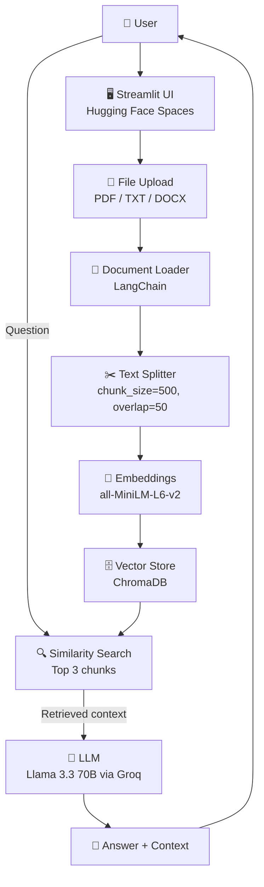
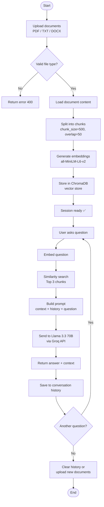

# RAG Document Q&A System

A production-ready Retrieval Augmented Generation (RAG) application that allows users to upload documents and ask questions based on their content.

## Live Demo
[huggingface.co/spaces/rado-zys/rag-document-qa](https://huggingface.co/spaces/rado-zys/rag-document-qa)

## Features
- Upload multiple documents simultaneously (PDF, TXT, DOCX)
- RAG pipeline with semantic search across uploaded documents
- Conversation history — model remembers previous questions
- Context transparency — see exactly which document fragments were used to generate each answer
- New Conversation button — reset session and load new documents instantly

## Architecture

### System Architecture



## Workflow



## Tech Stack
- **LLM:** Llama 3.3 70B via Groq API
- **Embeddings:** sentence-transformers/all-MiniLM-L6-v2
- **Vector Store:** ChromaDB
- **Framework:** LangChain
- **UI:** Streamlit
- **Deployment:** Docker on Hugging Face Spaces

## Local Setup
```bash
git clone https://github.com/r4dzys/ai-architect-journey
cd ai-architect-journey/rag-document-qa
pip install -r requirements.txt
export GROQ_API_KEY=your_key_here
streamlit run src/streamlit_app.py
```

## Project Context
Focus: understanding RAG architecture end-to-end — from document ingestion to production deployment.

## Author
Radosław Zys | [LinkedIn](https://linkedin.com/in/radoslaw-zys) | [GitHub](https://github.com/r4dzys)
